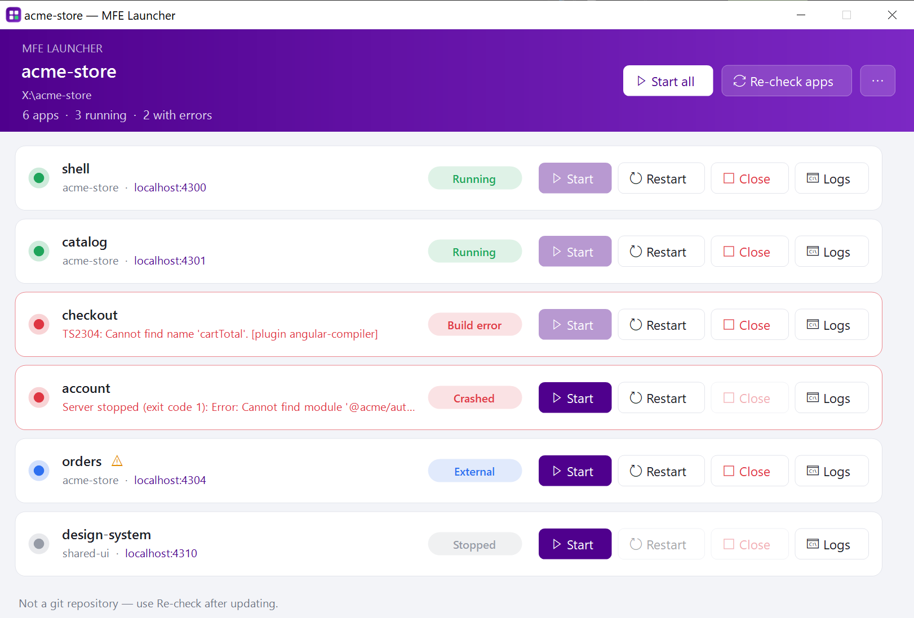

# MFE Launcher

A small Windows desktop app that starts, restarts and stops the micro-frontends of an **Nx monorepo** from one window. Each app gets its own status lamp, error notifications and logs. You don't need a terminal per app.

Drop `mfe-launcher.exe` into the root of your Nx workspace and double-click it. The launcher reads the workspace and lists every app that has a `serve` target. It needs no install and no config file, and the exe is about 100 KB.



## Features

- **Auto-discovery.** Lists every Nx app under `apps/*/project.json` that has a `serve` target. This covers the root workspace and any direct child folder with its own `nx.json`, such as a git submodule that holds shared apps.
- **Per-app controls.** Each app has **Start**, **Restart**, **Close** and **Logs** buttons, plus a clickable `localhost:<port>` link.
- **Live status lamp:** Stopped, Starting, Running, Build error, Crashed, Stopping, or External (served by a process the launcher didn't start).
- **Port-in-use warning.** A ⚠ icon appears when another process holds an app's port. Clicking **Start** offers to stop that process and start the app on its port in one step.
- **Bulk actions:** a **Start all** button, plus **Restart all** and **Close all** in the `⋯` menu.
- **Maintenance** in the `⋯` menu: **Reset Nx & clear caches** (`nx reset` plus `.angular/cache`) and **Clean npm cache**.
- **Error notifications.** When a build fails or a server exits, the app shows a tray notification and its card turns red with the first error line. If the window isn't focused, its taskbar button flashes.
- **Log viewer.** A colour-coded console for each app (errors, warnings and successes), with Open in browser, Copy and Clear buttons.
- **Git-aware.** After `git pull`, `checkout`, `merge` or `submodule update`, the list re-checks itself automatically. There's also a manual **Re-check apps** button.
- **No orphans.** Every dev server runs inside a Windows Job Object, so closing (or crashing) the launcher kills every server it started, including child processes.
- **Project-aware header.** The header shows the workspace name and its path (click the path to open the folder). The workspace name is also in the window title.

See [docs/features.md](docs/features.md) for the full tour.

## Requirements

| What | Version |
|---|---|
| Windows | 10 or 11. .NET Framework 4.8 is built in, so there's nothing to install. |
| Node.js | Any version your workspace supports, on `PATH`. Tested with Node 22. |
| Nx | A local `nx` in `node_modules` (run `npm install` first). Tested with Nx 23. |
| Apps | Each app has `apps/<app>/project.json` with a `serve` target and a fixed port. |
| Angular | Any version for start, stop and status. **Angular 17+** is recommended for build-error detection. Tested with Angular 22. |

The launcher has been tested with **Angular 22, Nx 23.1 and `@angular-architects/native-federation` 22** (Native Federation on Angular's esbuild builder). It also works with the Nx Module Federation (webpack) setup, plain Nx Angular apps, and any other app that `nx serve` can run.

See [docs/workspace-requirements.md](docs/workspace-requirements.md) for the micro-frontend patterns, the compatibility table and an example `project.json`.

## Quick start

### 1. Get the exe

**Download:** take `mfe-launcher.exe` from the latest release on the [Releases](../../releases/latest) page. Each release also has a `SHA256SUMS.txt` you can check the file against:

```powershell
Get-FileHash .\mfe-launcher.exe -Algorithm SHA256
```

**Or build it from source.** The only thing you need is any [.NET SDK](https://dotnet.microsoft.com/download) (6 or later):

```powershell
git clone <this-repo-url> mfe-launcher
cd mfe-launcher
.\build.ps1
```

The exe is written to `dist\mfe-launcher.exe`. To build it and copy it straight into a workspace:

```powershell
.\build.ps1 -Dest "C:\code\my-nx-workspace"
```

### 2. Put it in your workspace

Copy `mfe-launcher.exe` into the **root folder** of the Nx workspace, next to `nx.json`, and keep it out of git:

```gitignore
# .gitignore
mfe-launcher.exe
```

### 3. Run it

1. Run `npm install` in the workspace, if you haven't already.
2. Double-click `mfe-launcher.exe`. The first time, Windows SmartScreen may warn about an unsigned app: choose **More info → Run anyway**.
3. Click **Start** on an app, or **Start all**. The lamp turns amber while it builds and green once the port is listening.
4. Click the `localhost:<port>` link to open the app in your browser.

See [docs/getting-started.md](docs/getting-started.md) for a step-by-step first run.

## Documentation

| Document | Contents |
|---|---|
| [Getting started](docs/getting-started.md) | Building, installing, first run and updating |
| [Features](docs/features.md) | Every button, status and notification, with screenshots |
| [Workspace requirements](docs/workspace-requirements.md) | Nx monorepo layout, micro-frontend patterns, Angular and Nx versions |
| [How it works](docs/how-it-works.md) | Architecture, process handling, status logic, source map |
| [Troubleshooting](docs/troubleshooting.md) | Common problems and fixes |
| [Releasing](docs/releasing.md) | How the release pipeline builds and publishes the exe |

## Project layout

```
mfe-launcher/
├─ .github/workflows/
│  └─ release.yml         Builds the exe and publishes a GitHub release
├─ build.ps1              Build script (dotnet build + copy)
├─ src/                   C# WinForms source (.NET Framework 4.8)
│  ├─ MfeLauncher.csproj
│  ├─ Program.cs          Entry point
│  ├─ MainForm.cs         Main window, header, menu, bulk actions
│  ├─ AppCard.cs          One app row
│  ├─ LogForm.cs          Log viewer
│  ├─ MfeApp.cs           One app: process, status, log, error detection
│  ├─ AppDiscovery.cs     Finds workspaces, apps, ports and the nx binary
│  ├─ GitWatcher.cs       Watches git refs to re-check after pull
│  ├─ Maintenance.cs      nx reset / npm cache clean
│  ├─ Ports.cs            Port → PID table (GetExtendedTcpTable)
│  ├─ ProcessJob.cs       Win32 Job Object (kill children on exit)
│  ├─ Shell.cs            Runs a hidden command and captures output
│  ├─ Theme.cs, UiControls.cs   Colours, fonts, custom-drawn controls
│  └─ app.ico
└─ docs/                  Documentation and screenshots
```

## Limitations

- Windows only (WinForms, Win32 Job Objects, the Windows TCP table).
- Apps must declare `serve` in `apps/<app>/project.json`. Targets that exist only through Nx inference plugins, or apps in folders other than `apps/`, aren't listed.
- Nested workspaces are found only one level deep: the root, and its direct child folders that contain `nx.json`.
- An app without a fixed port works, but its status can't go beyond **Starting**, because the launcher detects "running" by the port.
