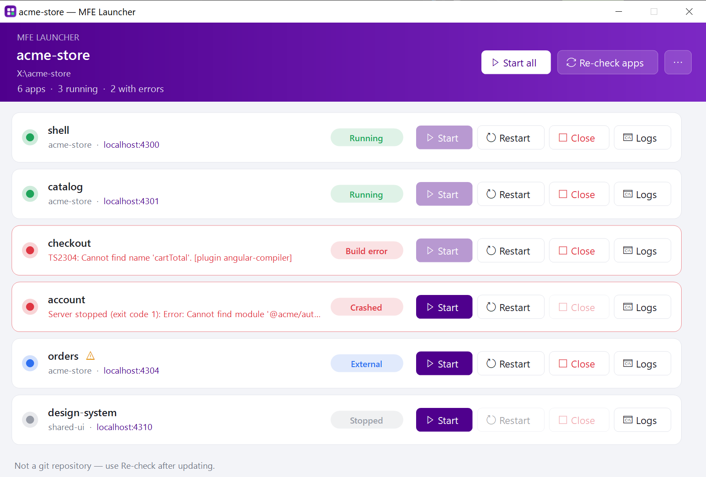
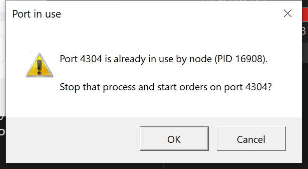
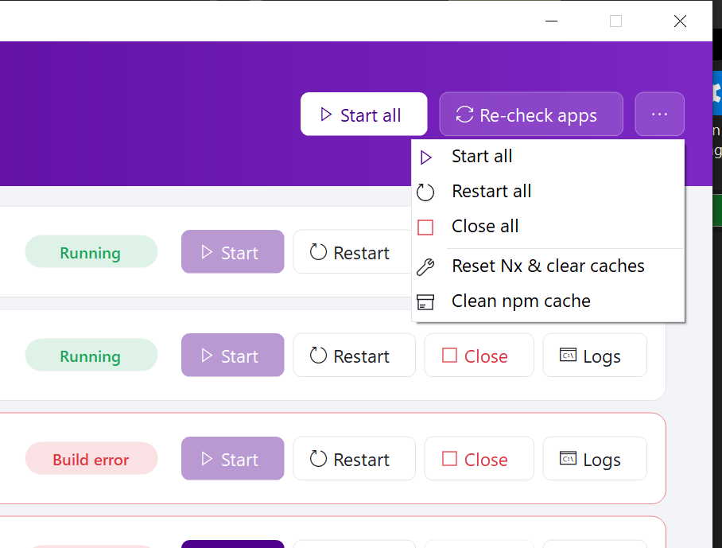
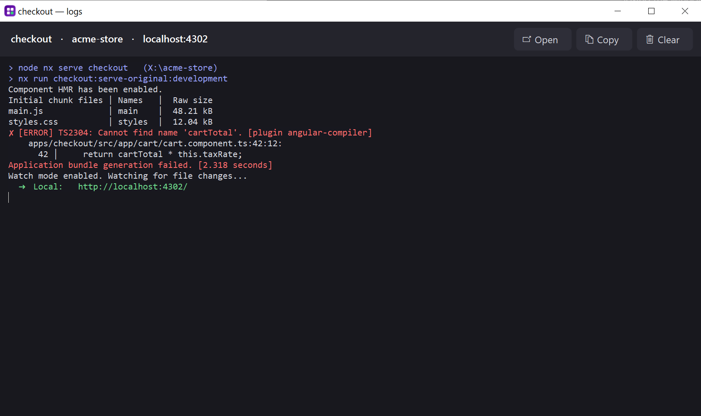

# Features

## Header

| Element | What it does |
|---|---|
| **Project name** | The workspace folder name, also shown in the window title (`<project> — MFE Launcher`), so you can tell several launchers apart in the taskbar. |
| **Project path** | The full workspace path. Click it to open the folder in Explorer. A long path is shortened with `…`; hover over it to see all of it. |
| **Summary** | `N apps · N running · N with errors`, updated every second. |
| **Start all** | Starts every app that isn't running from the launcher (see [Bulk actions](#bulk-actions)). |
| **Re-check apps** | Reads the workspace again for new, removed or renamed apps and changed ports. |
| **⋯** | Opens the actions menu. |

## App rows

Each row shows the following:

- **Status lamp and badge.** The lamp pulses while an app is starting or stopping.
- **Name.** The `name` from `project.json`, or the folder name when there is none.
- **Workspace and link.** The workspace the app belongs to and a clickable `localhost:<port>` link. When the app has failed, the first error line takes their place.
- **⚠ port warning.** Shown when another process holds the app's port. Hover over it to see which process (name and PID).
- **Buttons:**

| Button | Enabled when | Action |
|---|---|---|
| **Start** | Stopped, Crashed or External | Runs `nx serve <app>`. If the port is busy, it asks first (see below). |
| **Restart** | Running, Starting, Build error or Crashed | Stops the process tree, waits for the port to free up, then starts the app again. |
| **Close** | Any running state, including External | Kills the process tree that serves the port. |
| **Logs** | Always | Opens the app's log window. |

### Statuses

| Lamp | Status | Meaning |
|---|---|---|
| Grey | **Stopped** | Not running, and nothing is on the port. |
| Amber (pulsing) | **Starting** | The launcher's process is alive, but the port isn't listening yet (the first build is still running). |
| Green | **Running** | The launcher's process is alive and the port is listening. |
| Blue | **External** | Something the launcher didn't start is serving the port, such as a terminal or another launcher. |
| Red | **Build error** | The server is alive, but the latest build failed. This clears when a later build succeeds (on save, with watch mode). |
| Red | **Crashed** | The server exited without being closed from the launcher. |
| Amber (pulsing) | **Stopping** | The launcher is killing the process tree and waiting for the port to free up. |

### Port already in use

When an app's port is held by another process, the row shows ⚠. Clicking **Start** asks:

**OK** kills that process tree, waits for the port to free up, and starts the app in the launcher. All of this happens in a single action. **Cancel** leaves everything as it is.

## Bulk actions

| Action | Behaviour |
|---|---|
| **Start all** | Starts every app that isn't running from the launcher. If some ports are busy, one dialog lists them: **Yes** stops those processes and starts the apps there, **No** starts only the apps whose ports are free, and **Cancel** does nothing. |
| **Restart all** | Restarts every app the launcher started, plus any that crashed. |
| **Close all** | After you confirm, stops every running app, including External servers. The confirmation says how many External ones there are. |
| **Reset Nx & clear caches** | After you confirm, stops the launcher's apps first, then runs `nx reset` (daemon, `.nx` cache and workspace data) and deletes `.angular/cache` in **every** workspace. |
| **Clean npm cache** | After you confirm, runs `npm cache clean --force`. |

The maintenance actions run in the background. The footer shows progress, a notification confirms success, and a dialog shows the command output if one fails.

## Logs

- One window per app. It keeps the last 5,000 lines in memory, even while the window is closed.
- Lines are colour-coded: **red** for errors, **amber** for warnings, **green** for success (`bundle generation complete`, `Local: http://…`), and **blue** for the launcher's own lines.
- **Open** opens `http://localhost:<port>`, **Copy** copies the whole log, and **Clear** empties it.
- ANSI colour codes are stripped, and `FORCE_COLOR=0` is set for the child process.

## Notifications

The launcher raises an alert when:

- a build fails, once per failed build. Saving a fix that builds successfully clears the error;
- a server exits unexpectedly, for example a crash, a missing module, or a port taken by someone else.

For each one:

- a Windows notification appears from the tray icon, named after the app, with the first error line. Clicking it opens that app's logs;
- the app's row turns red and shows the error text;
- the taskbar button flashes if the window isn't focused.

## Git watching

The launcher watches the workspace's git directory, and the git directory of any nested workspace such as a submodule. When `HEAD`, `ORIG_HEAD`, `FETCH_HEAD`, `packed-refs` or a branch ref under `refs/heads` changes, it waits about 3 seconds for git to finish, then re-checks the app list:

- **New apps** are added, with a notification.
- **Removed apps** disappear, unless they're running from the launcher, in which case they stay until you close them.
- **Changed ports** are picked up for apps that aren't running.

The footer always shows when and why the last re-check happened.

## Closing the launcher

When you close the window, it asks for confirmation if apps are running from the launcher. Every server the launcher starts runs inside a Windows **Job Object**, so all of them, including their child processes, stop when the launcher exits, even if it crashes. Servers started outside the launcher (External) are never affected.
